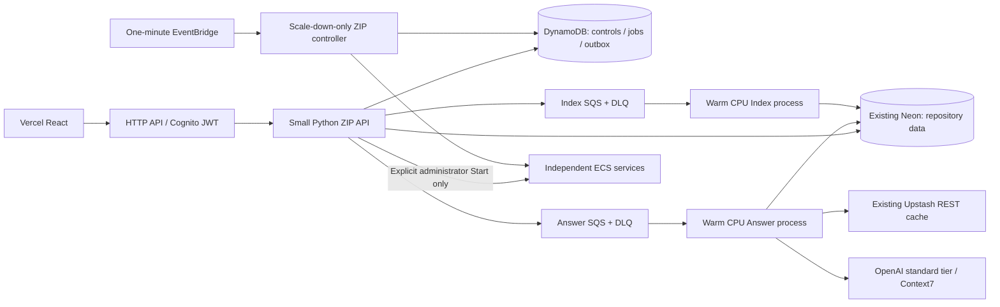

# Runtime architecture

The existing Vercel React SPA calls an AWS HTTP API protected by Cognito access tokens. API Gateway verifies signatures, issuer/audience and scopes; the ZIP handler checks issuer, client ID, access-token use and administrator group again. Browser headers never grant administrator rights.

## Browsing and data

`cloud_api.py` routes HTTP API v2 events without FastAPI/Mangum. `/health` imports no AWS SDK, database driver, ML framework, model, SSM or network client. Authenticated `/ready` probes Neon separately. `cloud_reads.py` uses parameterized, bounded read-only psycopg transactions, a reused connection, TLS, connection/statement deadlines and stable pagination. A dedicated database login receives SELECT privileges only.

Repository cards, counts, exact file snapshots, partial reconstructions, symbols, graph nodes/edges and dependencies come only from Neon. DynamoDB never stores repository cards or a parallel repository catalog. Large results and evaluation artifacts use private encrypted S3. API reads do not call ECS, enqueue work or load models.

Old indexes lacking snapshots expose `partial=true`, bounded reconstructed lines and an explicit note. Missing files return 404. Source text is never fabricated. Hosting is for authenticated reviewers of public GitHub repositories; it is not a private multi-tenant repository product.

## Controls, jobs and idleness

There is one control item per service, keyed `control#answer` or `control#index`. Start is an explicit administrator action, serialized with a short control-operation lease. That is the only code path with `desiredCount=1`. Stop rejects new submissions immediately, drains the current job for at most 15 minutes, leaves queued jobs paused, then scales down. Force stop may interrupt work. Fargate receives a 120-second stop timeout only after draining has already been handled.

Accepting a job transactionally creates its durable row and idempotency record, increments `pending`, removes `idle_since`, and creates an outbox marker. SQS messages contain only the job ID. Failed sends are reconciled through the dispatch GSI. A service accepts at most 20 outstanding jobs; the API also has a per-identity request budget.

Each message has a separate exception boundary. Conditional claims use attempt leases, worker identity and service generation. Visibility/leases renew during work; completed redeliveries ACK without recomputation. Permanent errors fail durably and enter the service's DLQ. Transient failures have three processing attempts. Expired crashed leases are recovered without losing outstanding-work accounting. Terminal state and counter decrement commit together. The controller also reconciles native SQS redrive of still-queued jobs into terminal failure, preserving the DLQ diagnostic message so an orphaned pending counter cannot keep compute on forever.

Workers publish readiness after DB validation, embedding warm-up, and—in Answer—reranker inference and graph compilation. The same interpreter and cached models serve successive jobs. A heartbeat says only that the process is alive; it never resets idleness.

The controller starts the idle clock only after readiness and **zero durable pending/running work plus zero visible/in-flight/delayed SQS messages**. At 3,600 continuous idle seconds it reserves control, rechecks and stops. Accepted work clears the timer. Browsing/status polling do not affect it. Active work can keep a service enabled beyond two hours. Startup failures and stale readiness have separate bounded shutdown rules. The timer never scales up.

## Configuration and caching

API, Answer and Index have separate SSM SecureStrings and IAM scopes. Values are written by the guarded secret-preparation script, never Terraform. The API receives a read-only URL; Index receives the writer URL; Answer receives the reader URL and only its provider/tool/cache secrets. Frozen non-secret provider/model/router configuration is baked into `release-config.json` and overrides mutable runtime values.

Upstash uses HTTPS REST with short deadlines and bounded values. Cache failures become misses. Answer/tool keys include hashed content/configuration, release/prompt fingerprints and tenant context where applicable. Evaluations bypass answer/tool caches. GitHub MCP remains deliberately unavailable; the existing missing-tool path returns a truthful partial answer when supported code evidence remains. Context7 uses hosted HTTP MCP in cloud and the existing stdio adapter locally.
