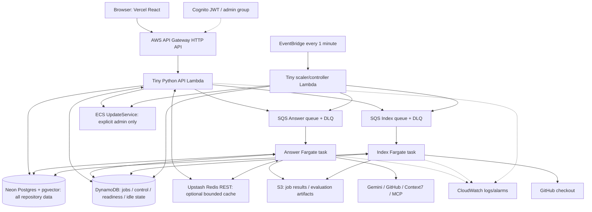
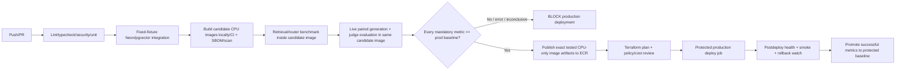

# RepoGuide — Cost-Aware AWS Production Migration and Deployment Plan

**Handoff to Codex in VS Code**  
**Plan date:** 2026-11-04  
**Repository:** `notnikhilreddy/RepoGuide` (`main` is the reference branch; inspect the local checkout before working)  
**Target AWS region:** `us-east-2` (Ohio)  
**Target hosting:** Vercel frontend + AWS HTTP API/Lambda + ECS Fargate + Neon + Upstash Redis  
**Status:** Implementation plan only; nothing in this plan has been deployed or modified by its author.

> **Instructions to the implementing agent:** Treat this as the acceptance contract. Inspect the real repository, AWS account, Terraform state, GitHub Actions settings, and connected provider configurations before editing. You have discretion on minor module boundaries and library versions, but **must preserve the non-negotiable requirements below**. Work in ordered phases, run the specified tests, save artifacts/evidence, and do not claim success unless verified. Never print or commit credentials. Do not delete existing Neon data or indiscriminately destroy working Terraform resources.

---

## 0. Non-negotiable product and operational requirements

1. **Neon PostgreSQL is the ONLY authoritative store for repository content and metadata.** Preserve existing repository records, code chunks, embeddings, exact source snapshots, symbols, edges, dependencies, versions/commits, and associated read models in Neon. Repository cards and overview counts must be queried from Neon, **not DynamoDB**. Avoid duplicating repository summaries in DynamoDB.
2. **General repository exploration works with both ECS services at desired count zero.** Landing page, repository list/overview, file explorer/Monaco file contents, symbols, dependencies, code graph, existing reports, and ordinary metadata queries must not invoke heavy Python/ML packages or start Fargate. Use a small API Lambda with bounded read-only Neon queries. If older repository indexes lack complete source snapshots, report accurate `partial`/missing state; do not fabricate files.
3. **Only the authenticated administrator may start/stop compute**, via explicit UI controls protected server-side by Cognito claims/identity allowlist and IAM. Page loading, asking a question, queue backlog, time-based schedules, job failures, or unauthenticated traffic **must never auto-start workers**. The administrator starts the **Answer** and **Indexer** services independently. Other authorized users may submit bounded jobs only while the matching service is intentionally enabled.
4. **Rolling 60-minute idle shutdown, NOT a two-hour hard cap.** Each manually enabled service remains on for any duration while it receives/executes jobs. Once the service is ready and has *no queued, running, retry-scheduled or in-flight work*, begin/restart an idle timer. After **60 continuous minutes with no such work**, scale that service to zero. A new accepted job before expiry resets the idle clock. Merely browsing, polling status, refreshing the tab, or receiving heartbeats **must not** reset the timer. If started but never given work, turn off about 60 minutes after readiness. Manual stop is allowed earlier, with a well-defined drain/force policy.
5. **Failed jobs are isolated.** A malformed/failed/timeout/poison job must not crash the SQS consumer loop, kill the ECS task, corrupt Neon, leave a job stuck forever, or block later messages. Give each message its own failure boundary, finite retries, DLQ, durable terminal state, and resource cleanup. A worker may process subsequent jobs even after prior jobs fail.
6. **Warm worker means genuinely ready.** Preload the query embedding model, cross-encoder reranker, compile/initialize the orchestration graph, validate outbound database access, run a tiny warm-up inference, and then publish readiness. Keep the same Python process and loaded models for subsequent jobs. Do not claim ECS `RUNNING` means the model is ready.
7. **Lambda is lightweight.** No PyTorch, `sentence-transformers`, MLflow server, LangGraph, Tree-sitter, model weights, heavy FastAPI monolith, or container image for ordinary API handling. Prefer small Python 3.12 ZIP functions. Lambda talks to Neon, DynamoDB, SQS, ECS, S3, and optionally Upstash over HTTPS; it does NOT perform AI inference or code indexing.
8. **Two separate Fargate ECS services and task definitions:** Answer worker and Index worker; independent `0/1` desired counts, CPU/memory selected from local **and real Fargate** measurements. One process can handle multiple sequential jobs without restart. Use only CPU-only ML dependencies, Linux container images and pinned image digests.
9. **Upstash Redis is a cache, not a source of truth or broker.** Use the provided Upstash REST deployment *after rotating the exposed token*. No ElastiCache cluster, self-hosted Redis, NAT Gateway, or always-on server. DynamoDB remains durable job/worker state; SQS remains the durable message queue; Neon remains repository data.
10. **Strict, fail-closed evaluation-gated deployment on prompt/model changes** (and other changes that affect answer quality): no new production backend image/config, runtime prompt, model, or relevant frontend behavior is promoted unless every mandatory evaluation metric and safety gate is **at least as good as the last approved production baseline**. A missing evaluator, empty dataset, unavailable key, timeout, inconclusive result, or worse required metric = **no deployment**. Preserve an auditable baseline and automated regression report; do not silently reset the baseline to a poorer candidate.
11. **Minimal idle cost and no surprise compute:** ECS desired count defaults to zero. Existing static AWS resources, AWS credits, Neon free limits, Upstash free limits, ECR storage and external API costs still count. Set budgets, alarms, rate limits, log retention and ECR retention. GitHub CI/evaluation must be cost-bounded.
12. **Deployment must be real, verifiable and reversible:** inspect and preserve existing Terraform state, test locally, push images to **ECR** (not directly to ECS), apply Terraform, update ECS to immutable image digests, deploy Lambda ZIPs, configure Vercel, run smoke/integration/failure/idle tests, log measured results and document rollback.

### Security action required before implementation

A live-looking `UPSTASH_REDIS_REST_TOKEN` was included in the chat request. **Treat it as exposed and rotate/revoke it immediately in the Upstash console** before first use. Do not place it in this file, `.env.example`, a source file, Terraform variables/state, a command echoed to the terminal, a PR, GitHub Actions logs, or a prompt. Ask the owner to store a **newly rotated token** securely as an SSM SecureString or suitable protected secret store, and use a separate CI token where appropriate. The Upstash REST endpoint is non-secret but still should be configuration; use a normal `https://` URL (no shell-escaped backslashes). See [Upstash REST token documentation](https://upstash.com/docs/redis/features/restapi).

**Prerequisites Codex should verify, not assume:** authenticated AWS CLI access and correct account/region, existing Terraform state and any remote backend, correct Neon pooled URL/read-only credentials, Cognito admin identity/group, Vercel project access, newly rotated Upstash token, LLM/evaluation keys, repository write permissions, GitHub Actions OIDC role, available AWS credits and spend limits. If any are missing, implement/test the safe parts and report the exact blocker; never fabricate credentials or proceed with a destructive substitute.

---

## 1. Starting-point audit: inspect before editing

The repository currently contains these relevant files/modules. **They are pointers, not an assumption that the local branch is identical to the inspected remote branch:**

- `src/repoguide/cloud_lambda.py`: currently loads the original FastAPI monolith through Mangum; replace its deployment responsibility with a tiny API application.
- `src/repoguide/main.py`, `ui_api.py`, `graph_api.py`, `api.py`: current API route contracts; preserve or carefully version the React-facing functionality.
- `src/repoguide/cloud_bootstrap.py`: SSM configuration hydration; segregate worker secrets and lightweight API configuration, and ensure no heavyweight imports.
- `src/repoguide/cloud_worker.py`: existing indexing SQS consumer; adapt into a robust, isolated index worker and add a separate answer worker.
- `src/repoguide/cloud_jobs.py`, `cloud_scaler.py`, `cloud_guard.py`: current DynamoDB/SQS/ECS operations; remove all implicit queue-triggered auto-wake behavior; introduce separate worker control states and rolling idle logic.
- `src/repoguide/db.py`, `models.py`, `ui_api.py`, `graph_api.py`: Neon data models, browsing queries and existing source-file/graph data.
- `src/repoguide/indexer.py`, `intelligence.py`, `chunking.py`, `embeddings.py`: indexing code and embedding model.
- `src/repoguide/pipeline.py`, `workflow.py`, `retriever.py`, `hybrid.py`, `reranker.py`, `router.py`, `external_tools_v2.py`, `answers.py`, `provider.py`, `llm.py`: existing RAG/agent/answer pipeline; preserve semantics and observed quality.
- `src/repoguide/cache.py`: currently based on the standard `redis` TCP client; change to an Upstash REST-backed abstraction in cloud without breaking local Redis use.
- `src/repoguide/telemetry.py`: MLflow tracing with optional remote tracking; keep tracking optional in production and never force an MLflow server to run continuously.
- `frontend/src/lib/api.ts`, `frontend/src/lib/types.ts`, `frontend/src/App.tsx`, `frontend/src/components/*`: UI and API contracts; add compute controls and async job states while retaining Monaco/graphs/evaluation panels.
- `docker/Dockerfile.lambda`, `docker/Dockerfile.worker`, `pyproject.toml`, `uv.lock`: current images share heavy dependencies; **split deployment dependencies** and produce two minimal CPU-only worker images plus tiny Lambda ZIP(s).
- `infra/terraform/*.tf`: existing infrastructure in `us-east-2`, including Lambda, ECS, API Gateway/Cognito, DynamoDB, SQS, ECR, S3, CloudWatch, EventBridge and budget alerts. Modify in place carefully.
- `.github/workflows/m8-containers.yml`: currently builds/pushes images on `main` without an evaluation gate. **Disable/refactor before enabling production deployments**. Prevent Vercel auto-deploy from bypassing quality controls for gated changes.
- `evals/README.md`, `benchmark_m3.py`, `run_m6_mlflow.py`, `benchmark_m5_live.py`, `benchmark_router_m6.py`, `ci_gate.py`, evaluation JSON datasets and `tests/`: reuse/extend, don't discard the existing benchmark history.

**Known earlier AWS problems**: Lambda reserved concurrency quota (`PutFunctionConcurrency`), unexpected SSM keys, malformed SQLAlchemy URL, and 29-second Lambda startup/HTTP 503. The new API Lambda must avoid the import chain that caused those failures. Keep Lambda reserved concurrency unallocated unless the account quota actually supports a safe limit.

### Audit deliverables

Create `docs/deployment/audit.md` (or equivalent) documenting:

- Current Git commit, branch, uncommitted changes, dependency versions, actual repository structure and frontend build setup (Vite/React, not assumed Next.js).
- `terraform state list`, outputs, provider lock file, backend location, `terraform plan` drift, ECS services/counts, ECR image sizes/digests, Lambda packaging, Vercel env, existing queues and IAM policies. **Redact identifiers if exporting or sharing.**
- Neon schema version (`alembic current`), table counts/storage/pgvector indexes and which indexed repositories have complete source snapshots. Take a tested backup or use a safe Neon branch before migrations.
- Current test/evaluation passing/failing status, paths in gold datasets that refer to outdated repository commits, representative production benchmark baseline and active GitHub workflows.
- Project spending baseline (Cost Explorer), existing budgets, public IPv4s, ECR storage, CloudWatch custom metric counts and any orphaned resources.
- A gap/diff table showing what will be **kept, changed, added, removed**, with risks, migrations, rollback and expected monthly cost.

**Stop/go:** Do not run `terraform destroy`, recreate Neon, rename state-backed AWS resources blindly, or replace production indexes as a debugging shortcut.

---

## 2. Target architecture and boundaries



### Service responsibilities, why each is used, and why alternatives are omitted

| Service | What it is used for | Reason; important limits |
|---|---|---|
| **Vercel** | Existing React static SPA/assets, router, chat UI, Monaco, graphs, job progress and administrator-only worker controls | Keeps frontend hosting simple; ensure production builds do not bypass evaluation gates. Frontend must not contain database, Redis or AWS secrets. |
| **Cognito** | Sign-in; JWTs; administrator group/subject mapping | API Gateway verifies JWT; backend verifies admin authorization again for control routes. Never trust a browser-supplied admin flag. |
| **API Gateway HTTP API** | HTTPS entry point, CORS, JWT authorizer, request throttling, access logs | No load balancer or long-lived public Fargate endpoint. Answers are async; do not hold an HTTP call open for LLM generation. |
| **Small API Lambda ZIP** | Repository **reads from Neon**, protected worker start/stop, enqueue jobs, status/result retrieval, feedback | Tiny handler fast to import; no local ML models. Network/database time remains a latency contributor; use pooled Neon, TLS and bounded timeouts. |
| **Neon PostgreSQL + pgvector** | Sole repository source of truth: repos, commits, source files, chunks, embeddings, symbols, edges, dependencies, metadata, counts | Reuses actual data, supports ordinary SQL/FTS/pgvector; enforce read-only browsing role; DB can autosuspend and free storage limits matter. |
| **DynamoDB** | Durable operational jobs, idempotency, work generations, worker control/readiness, last activity, failure/lease state | On-demand request costs, no server; NOT an alternate repository database. Use conditional writes for races. |
| **SQS ×2 plus DLQs** | Durable isolated queues for answer and indexing jobs, retry and at-least-once delivery | Frontend and Lambda never wait for long tasks. Queue depth must not start workers. |
| **ECS + Fargate Answer** | Loaded embedder/reranker, hybrid/graph retrieval, LangGraph router, MCP tools, Gemini requests, deterministic verification | Heavy CPU/network workloads and reusable models; desired count 0 or 1. |
| **ECS + Fargate Indexer** | Clone, parse, chunk, embed, graph, persist to Neon and optional S3 artifacts | Long-running CPU/IO jobs isolated from answer latency. |
| **Upstash Redis (REST)** | Best-effort short-TTL read/result/tool caches with tenant-safe keys and versioning | Existing REST endpoint is appropriate for Lambda/Fargate; do **not** confuse REST credentials with `redis://` TCP credentials. Never use for durable jobs or worker state. |
| **S3** | Private larger job results and optional evaluation artifact exports, not canonical source files | Keeps DynamoDB items bounded and jobs inspectable. Use SSE-S3, no public access, lifecycle. |
| **ECR** | Two minimal worker images, content-addressed, immutable tagged/digest references | ECS pulls these images; `docker push` does not deploy by itself. |
| **SSM Parameter Store** | Runtime secrets securely supplied to the right tasks/functions | Separate scope for Lambda read-only DB credentials versus worker secrets; avoid putting plaintext in Terraform state. |
| **EventBridge + tiny controller Lambda** | Periodically reconcile manually enabled sessions, idle timers and ECS desired counts | Required to stop ECS service at 0; worker process exit alone would otherwise be replaced. Never auto-scale up from queue. |
| **CloudWatch** | Runtime logs, failure/latency monitoring, DLQ and ECS alarms, budget observability | Short log retention, avoid verbose traces and excessive custom metrics. |
| **Terraform** | Repeatable infrastructure with safe state management and outputs | Preserve live resources; use separate runtime control of desired task count and CI deploy by image digest. |
| **GitHub Actions + protected deployment environment** | Build, tests, eval comparison, images, verified release, auditable rollback | Gated production releases; access AWS via constrained OIDC, no long-lived access keys. |

**Intentionally not introduced:** RDS, ElastiCache, EC2, EKS/Kubernetes, NAT Gateway, always-on ALB, permanently running worker, continuously hosted MLflow, separate vector DB, SQS-to-Lambda event mapping that starts compute, automatic queue-based ECS scale-out, or per-question Fargate RunTask. Evaluate these only if measured requirements later demand them.

---

## 3. Detailed request contracts and flows

### 3.1 General exploration — works while all workers are stopped

Expected flow: `Browser → API Gateway → tiny Lambda → Neon pooled PostgreSQL → Lambda → Browser`.

Suggested compatible routes (keep current paths as aliases where practical; version new contracts only when unavoidable):

| Route | Backing data | Limits and behavior |
|---|---|---|
| `GET /health` | Lambda local state only | No network, DB, SSM or Redis dependency. Lightweight API liveness. |
| `GET /ready` | Optional shallow Neon `SELECT 1` with timeout | Distinguish database degraded from Lambda down; do not block `/health`. |
| `GET /api/ui/repositories` | Neon `Repository` | Bounded pagination, stable ordering, counts from indexed aggregates/materialized Neon summary fields as justified. |
| `GET /api/ui/repositories/{id}/overview` | Neon | Repo details, counts, languages and graph summaries; avoid N+1 queries. |
| `GET /api/ui/repositories/{id}/files` | Neon `SourceFile`/`Chunk` | Paginate and bound entries; preserve partial-source markers. |
| `GET /api/ui/repositories/{id}/file?path=...` | Neon `SourceFile` | Validate paths, enforce file size/line limits, preserve exact vs reconstructed provenance. |
| `GET /api/ui/repositories/{id}/symbols-in-file` | Neon `CodeSymbol` | Bounded query, indexed `(repo_id,file_path)` access. |
| `GET /repositories/{id}/graph` | Neon symbols/edges | Page or window large graphs; render pan/zoom/highlighting in React. |
| `GET /repositories/{id}/dependencies` | Neon `RepoDependency` | Sorted bounded results; no external requests. |
| `GET /api/ui/evaluations`, report views | Existing static/versioned reports in S3 or other vetted artifact store; canonical repo metadata still Neon | Read-only and accessible without compute. Don't silently fake reports absent from deployed image. |

**Implementation rules:** use a dedicated minimal browsing package and Neon read-only PostgreSQL role; psycopg or tiny SQL adapter is enough. Avoid importing `repoguide.main`, `indexer`, `pipeline`, `torch`, `sentence_transformers`, `langgraph` from this handler. Use Neon pooled endpoint over TLS, per-request statement timeout, max connections, connection reuse/reconnect and safe parameterized SQL. Prefer server-side aggregates in Neon only if measurements justify their maintenance. Optional Upstash TTL caching for commonly reread metadata; cache misses always fall back to Neon.

### 3.2 Admin starts a worker — only explicit UI action

1. React calls `POST /api/compute/{answer|index}/start` with Cognito JWT, CSRF-safe method/headers and no secrets.
2. API Gateway validates JWT; Lambda independently checks administrator claim/allowlisted Cognito `sub` and current account policy.
3. Lambda performs **conditional DynamoDB update** on `control#answer` or `control#index`, reserving a new generation if stopped, with `desired_state=on`, `status=starting`. Repeated concurrent clicks are idempotent (no duplicate starts).
4. Lambda calls `ecs:UpdateService(desiredCount=1)` for exactly the matching service. On error, record a failed control operation and surface actionable status; do not claim the worker is running.
5. Return HTTP `202` quickly with control state/generation; do not block until the worker loads.
6. ECS launches one Fargate task, pulls immutable ECR image, installs its execution environment, obtains secrets, validates Neon connectivity, preloads necessary models, and reports `ready` only after warm-up and a generation-fenced heartbeat.
7. UI polls `/api/compute/status` moderately while starting, and shows `stopped / starting / loading / ready / draining / stopping / failed`, `last_job_at`, `idle_since`, and estimated *idle* shutdown time. **Do not show a fixed two-hour countdown**.
8. If task readiness fails repeatedly or exceeds configured startup timeout, controller marks `failed`, alerts, and sets desired count zero to avoid replacement loops and unexpected spend. Admin can explicitly retry.

**No automatic activation:** `GET /repositories`, landing-page navigation, queue depth, error retry, stale state recovery, and background EventBridge runs may **stop** compute, but may not change desired count 0→1. Only authenticated explicit admin Start does that. If ECS replaces an unexpectedly crashed worker while its manually authorized service remains enabled, that is permitted self-healing, subject to bounded restart/ready failures.

### 3.3 Question submission and answer processing

1. If Answer is `stopped`/`draining`/`failed`, the frontend shows AI offline; `POST /ask-jobs` returns a clear 409/503-style operational status and **does not queue or wake a task**. When `starting`, optionally accept bounded queued jobs tied to the same authorized generation.
2. Validate repo visibility/ownership, question length, top-K, mode, answer depth, docs policy, daily/user cost quota and idempotency key. Ensure the requested repo is indexed in Neon.
3. Create a durable DynamoDB `job#uuid` row; send a small **ID-only** message to Answer SQS (do not put private prompts/credentials in SQS bodies). Handle partial failure between DDB+SQS with an idempotent reconciler / transactional-outbox-like recovery; never orphan accepted jobs.
4. Lambda returns `202` with job ID within a short latency budget; React polls job status. Existing UI should show true stages (`queued`, `embedding`, `retrieval`, `rerank`, `routing`, `mcp`, `generation`, `validation`, `complete`) and errors honestly.
5. A warm answer worker polls SQS continuously, claims the job conditionally in DynamoDB with an attempt lease and generation token, runs embeddings, Neon dense/keyword/graph retrieval, optional cross-encoder reranking, LangGraph, MCP/Context7/GitHub, Gemini call, citation checks and output validation.
6. Store durable result in DynamoDB **only if safely below item-size constraints**, otherwise store encrypted S3 artifact and its reference. Never store all source files in DynamoDB. Set `status=complete` by conditional update; ACK/Delete SQS only after durable success.
7. Frontend retrieves status/result through Lambda with ownership checks. Cache optional verified answers in Upstash using repository commit+model+prompt+provider+retrieval config+tenant namespace. For identical repeat questions, a safe cache hit can be served while the Answer service is **manually enabled**, avoiding a new Gemini call. **When the Answer service is stopped, the Ask endpoint remains offline even if an older answer exists in cache**; never auto-start compute on a cache miss.
8. A second question to the ready worker must reuse the same Python interpreter, embedding model, reranker, LangGraph setup and healthy database connections; no model downloads or container launches per question.

**No synchronous 29-second HTTP AI request.** Replace hosted `POST /repositories/{id}/ask/robust` semantics with an async job adapter and update `frontend/src/lib/api.ts` / UI accordingly. Retain a local synchronous dev path if valuable, but cloud must not depend on it. Full token-by-token streaming is **not** a first-release promise with SQS/polling; show honest stage progress and deliver validated complete answers first.

### 3.4 Indexing submission and completion

- Indexer service is independently started with admin control; `POST /index-jobs` only allowed while enabled/starting; never wakes ECS itself.
- Validate GitHub URL, repo size, permissions, dedupe/idempotency, target commit/ref, whether already indexed; reject SSRF/non-GitHub paths and limit fetch size/time.
- Worker reads one SQS job, clones at pinned commit, runs current parser and Tree-sitter symbol/dependency/graph logic, chunks content, embeds in CPU batches, writes to a **transactionally safe Neon staging/version context** and atomically publishes completed indexed version. Preserve old version until successful publication; on failure rollback/cleanup so exploration remains consistent.
- Store exact supported source snapshots in Neon as currently modeled; no requirement to move repository data to S3 or DynamoDB. Optional large job/evaluation artifacts may go to S3.
- Update DynamoDB job status/progress/attempts, ACK only when committed and state is terminal complete. Indexer stays warm waiting for more jobs, until 60 continuous idle minutes or explicit Stop.
- Indexing and answering may be enabled concurrently; both should not overwhelm Neon. Set per-service concurrency and DB pool budgets, no unbounded parallelism.

### 3.5 Job failure, retry, poison-message and recovery contract

- Use a per-job `try/except/finally` around **every** SQS message, not one big exception handler that terminates the worker. Log sanitized structured errors and a correlation/job ID; clean DB sessions, subprocesses, temporary cloned repos, locks and visibility heartbeat threads in `finally`; continue the poll loop for future jobs.
- Classify **permanent** errors (invalid URL, forbidden repo, invalid request/schema, predictable bad model output) versus **transient** errors (Neon network outage, Gemini 429/5xx, HTTP timeout, intermittent S3/SQS errors). Permanent failures: mark terminal `failed` and ACK so a poison message cannot monopolize the queue. Transient failures: bounded retry with backoff/jitter; only retry safe idempotent operations. After max attempts, mark terminal failed and route/retain sanitized diagnostic in DLQ. Use separate DLQ for each queue.
- Handle provider failures with explicit timeouts; optionally produce a truthful partial/abstaining answer **only if validation permits**. A provider failure must not be silently reported as a successful answer.
- Renew SQS visibility during long jobs (never assume 15 minutes is enough for indexing); avoid duplicates with DynamoDB conditional claims and attempt leases. AWS SQS visibility has a 12-hour maximum from receipt; for exceptionally long jobs break work into checkpoints/jobs. Use a bounded attempt count, e.g., 3 transient receives, configurable after tests.
- Job states: `queued -> running -> complete`; `queued/running -> retrying -> queued/running`; `queued/running -> failed`; `running -> cancel_requested -> cancelled/interrupted`. Make transitions conditional on current state, attempt and generation; refuse late writes from stale tasks.
- Worker service failure must be tracked independently from a single job failure. A bad job should not alter worker readiness or desired count. After repeated process crashes/OOM, bounded startup failure policy switches to `failed` and scales down, with clear admin intervention.
- If interrupted during a Neon index write, rollback or use versioned staging; no partially published graph. If interrupted after writing result but before deleting SQS, redelivery sees `complete` and ACKs without redoing expensive work.
- Add fault-injection tests: malformed JSON, unknown job ID, database exception, network timeout, Gemini quota error, repeated duplicate delivery, SIGTERM during clone and generation, DLQ exhaustion, fail-then-successive-healthy-job, heartbeat failure and stale controller generation.

### 3.6 Manual Stop and one-hour auto-stop

**Definition of idleness:** Per service, `idle_since` is set when the worker is *ready* and all of the following are true: zero queued jobs, zero running/leased jobs, zero retry-scheduled work and zero messages visibly/in-flight in its SQS queue. It is cleared as soon as a newly accepted job exists or a job starts. After the last job becomes terminal (complete/failed/cancelled) and the queue is empty, it begins again. Job processing, not page traffic, determines activity.

- Reconcile every ~1 minute (EventBridge rule → small controller Lambda). Use the **durable job/lease state as authoritative**, with SQS visible/in-flight counts as extra safety checks (SQS attributes are approximate); use conditional writes and recheck immediately before scale down. Do not rely on heartbeats as evidence of a job, or allow them to keep a worker alive forever.
- On manual Start, do **not** start the idle clock until a ready worker can accept jobs; if it never becomes ready, use separate readiness timeout and stop the failed task. A ready worker with no work starts its 60-minute idle timer.
- On any accepted/active/retrying job, clear `idle_since`. On terminal job, set `idle_since` only if no other work remains. The actual auto-stop is no earlier than 3600 seconds of uninterrupted idleness, typically within one reconciliation interval afterward.
- No hard wall-clock maximum of two hours (or any absolute deadline) for an actively working service. If jobs arrive regularly every 30 minutes, worker can remain on indefinitely. **Make the resulting cost tradeoff visible in UI and Cost Explorer.**
- Manual **Stop**: switch control to `draining` and reject new submissions immediately. Default graceful option stops polling *new* jobs, lets current job finish if within a bounded grace, and then sets desired count zero; queued-but-not-started work remains paused until the next explicit Start. Provide a clearly confirmed **Force stop** for emergencies that terminates after short grace; jobs are marked interrupted/retryable. Do not promise an indefinite graceful shutdown: Fargate container `stopTimeout` is at most 120 seconds after ECS starts stopping a task, so complete long drains **before** initiating ECS scale-in.
- Auto-stop must **never** interrupt a running job. On a clean idle timer expiry, set desiredCount 0, wait for ECS convergence, mark worker stopped. Explicit `stopped` intent must fence out scheduled restarts caused by old queue messages. When two services run, track idle independently.
- Preserve `lifecycle { ignore_changes = [desired_count] }` where runtime controller owns counts, but initialize to zero and verify Terraform rollout does not surprise-start workers.
- Add explicit admin action telemetry (who/when/which service), deterministic state machine tests and edge-case tests for Start/Stop races.

### 3.7 Additional cases

| Case | Expected behavior |
|---|---|
| Landing page with workers off | Reads repository rows/counts directly from Neon, shows both stopped. Zero ECS calls. |
| Open graph/code/dependencies while off | Same Neon path; all general exploration remains functional. |
| Non-admin clicks/forges Start | UI hides/disables; backend returns 403; no ECS update. |
| Ask while stopped | Offline response; no SQS message and no auto-start. |
| Ask while starting | Bounded queue allowed if explicitly manually enabled; progress says waiting for ready. |
| Two users share ready task | Separate ownership/rate limits; bounded local concurrency/queueing. |
| User closes browser | Work continues; auto-stop only after no jobs for 60 minutes. Browser cannot extend lease. |
| Failed answer followed by healthy answer | Failure terminal/retry as appropriate; next message processed normally. |
| Worker process crashes during authorized on state | ECS may replace once; generation/attempt fencing prevents stale writes. Bounded restart failures stop service and alert. |
| Worker OOM or repeated startup errors | Stop-restart loop, mark failed, allow admin to fix and retry. |
| Neon asleep | Small first-query resume delay; safe reconnection, short timeout and clear error. |
| Neon unavailable | Browsing degrades explicitly; jobs use bounded retry, no fake repo data. |
| Upstash unavailable | Bypass cache; compute from Neon/worker, no job or browsing outage. |
| SQS delivery duplicated | Conditional lock/idempotency prevents repeated durable side effects. |
| DLQ contains messages after terminal failure | Inspector/UI/admin alert; DLQ presence alone cannot start workers or keep them alive forever. |
| New release during active job | Preserve in-flight work or drain safely; do not surprise-start stopped service. |
| Redis cache after prompt/model change | Versioned keys automatically miss; evaluation bypasses cache. |

---

## 4. Upstash Redis caching strategy

### Mandatory connection design

The supplied Upstash variables are `UPSTASH_REDIS_REST_URL` and `UPSTASH_REDIS_REST_TOKEN`, **not** an ordinary TCP `REDIS_URL`. The current `redis.Redis.from_url()` client in `src/repoguide/cache.py` expects `redis://`/`rediss://` and must not be given an HTTPS REST URL. For cloud, use the official `upstash-redis` Python REST SDK (or equivalent small bounded HTTPS adapter):

```python
# Example interface only; obtain values from injected secret environment.
from upstash_redis import Redis
client = Redis.from_env()  # UPSTASH_REDIS_REST_URL and UPSTASH_REDIS_REST_TOKEN
```

Implement a `CacheBackend` interface so local development can continue using standard Redis if desired, while AWS uses Upstash REST. Prefer no Redis client import in `/health`. Cache access failures must be treated as misses with short connect/read timeouts. Prevent raw queries, prompts, keys, tokens and private source text from appearing in metric labels/logs.

### What to cache, how, and for how long (starting suggestions)

| Cache | Key (hash inputs; include environment/version/tenant where relevant) | Initial TTL | Notes |
|---|---|---:|---|
| Repository list/summaries | `env:repo-list:v{schema}:page:filter` | 30–120 seconds | Neon remains authoritative. Invalidate/purge version after indexing commit or status changes. |
| Repo overview/counts | `env:repo-overview:{repo}:{commit}:v{schema}` | 5–15 minutes | Precomputed aggregates in Neon preferable if queries proven expensive. |
| Small symbol/dependency/graph subsets | `env:repo-graph:{repo}:{commit}:page:{limits}` | 5–30 minutes | Cap payload size; don't cache giant graphs/files blindly. |
| Validated final answer | `env:answer:{tenant}:{repo}:{commit}:{question-hash}:{retrieval-version}:{model}:{prompt-hash}:{policy}:{depth}` | 5–30 minutes | Only validated/authorized results. Never cross-share tenant-private content. |
| MCP tool response | `env:mcp:{tool}:{dependency-version}:{query-hash}` | 10–30 minutes | Respect provider freshness and change detection. |
| Negative/cache-miss | Carefully typed failures only | 10–30 seconds | Do not cache 401, 403, credentials failures, provider rate limits or transient 5xx as real answers. |

Mandatory tests: correct tenant isolation; correct prompt/model/repo-commit invalidation; expiry; quota failures; Upstash 429/timeout; no credential leak; cache hit/miss accounting; no incorrect cached answer counted as new evaluation success. Disable or bypass caches during quality-gate evals to avoid hiding candidate regressions. SQS/DynamoDB remain durable even when Redis is empty or unavailable.

Cost target: keep within the Upstash Free plan if possible (as listed on its pricing page at plan time: **256 MB and 500,000 commands/month**). Measure actual commands/payload bandwidth; avoid chat-stage polling through Redis. Do not expose the Standard REST token in the browser.

---

## 5. CPU-only images, dependency boundaries, and local sizing

### Deliver three small deployment artifacts

1. **API Lambda ZIP** — smallest handler including only HTTP routing/serialization, Cognito claim access, DynamoDB/SQS/ECS clients and minimal Neon/PostgreSQL connectivity; optional tiny Upstash REST client. Prefer standard library + managed runtime AWS SDK and `psycopg` binary wheel, or a small FastAPI/Mangum package if compatible route contracts justify it. **Never install `torch`/HF/LangGraph/MLflow/model files in this ZIP**. Keep controller/scaler as its own even tinier ZIP.
2. **Answer worker image** (`linux/amd64` initially) — Python CPU runtime, `sentence-transformers`/CPU-only PyTorch, CrossEncoder, SQLAlchemy/pgvector, LangGraph, Gemini SDK, MCP tools, safe caching/observability and exactly necessary libraries. No indexing-only parser/compiler/git dependencies unless proven necessary by the answer pipeline.
3. **Indexer worker image** (`linux/amd64` initially) — Python CPU runtime, embedding model, parser/Tree-sitter and Git, PostgreSQL/pgvector and AWS SDK; no LLM generation/provider clients, agent graph, reranker or MLflow UI unless actually used for indexing.

**Don't use one giant `pyproject.toml` dependency list in every image.** Use `uv` extras/dependency groups or separate lockable deployment manifests (e.g., `api`, `answer`, `index`, `eval`, `dev`). Preserve reproducible versions with lock files, dependency integrity checks and CI. Pin compatible CPU-only Torch index for Linux (`https://download.pytorch.org/whl/cpu`). Inspect the actual built wheel inventory; fail if any CUDA/NVIDIA wheels/libraries are present, unless an unavoidable transitive dependency is justified/documented. On Apple Silicon Macs, cross-build with `docker buildx --platform linux/amd64`; use x86 CI runners and Fargate measurements for representative performance because emulation distorts timings.

### Build optimization checklist

- Multi-stage builds, slim/pinned base images, `--no-dev`, `--no-editable` or equivalent immutable install, `.dockerignore` excluding `.git`, `.env*`, local caches, test reports, node modules, PDFs, evaluation datasets and local volumes from production images.
- Download/verify/pin only the exact embedding model weights (MiniLM 384-dimensional) for the correct image, and CrossEncoder weights in Answer only **at image build time**. Set read-only HF offline runtime cache and proper UID ownership; model preload/warm-up at process startup. Avoid runtime model downloads and uncontrolled Hugging Face traffic.
- Avoid duplicating Hugging Face cache/model weights and pip/uv cache in image layers. Use BuildKit cache mounts outside final layers; clean OS package cache; include only `git`, CA certs, parser shared libraries and runtimes each service actually needs. Run as non-root, read-only filesystem where compatible, no inbound exposed ports.
- Use only pinned, reproducible base image digests and final image digests for ECS. Enable ECR image scan and run dependency/SBOM vulnerability scan; exclude secrets from all layers and build history.
- Benchmark two worker CPU/RAM settings at representative workloads, then choose minimal stable configuration. **Starting hypotheses, not final allocations:** Answer `1 vCPU / 4 GiB`; Index `1 vCPU / 4 GiB`. Compare Answer `0.5 vCPU / 2–4 GiB` if memory fits and `2 vCPU / 4–8 GiB` if p95/cpu saturation requires it; Index similarly evaluate heavy test repo peak. Use only valid Fargate CPU/memory combinations.
- Benchmark cold start (task requested, provisioned, image pull, process import, SSM hydration, model load, ready) and warm workload p50/p95, RSS peak, CPU percent, IO, image pull duration and ECR image storage. Keep peak resident memory comfortably below allocated task memory (initial guardrail ≤75–80% under representative load) with no OOM, swap assumption, missing model files or 29-second API limitation.
- Evaluate ARM64 later only if all CPU wheels, Tree-sitter grammars and model dependencies are available; keep `x86_64` until fully tested. Fargate Spot is optional for retryable Index jobs, not the default reliable single Answer service.
- Optionally benchmark SOCI lazy image loading for large compatible ECR/Fargate images; do not assume SOCI reduces time to import PyTorch/model weights. If images are sufficiently small, don't spend extra complexity on SOCI.

### Local end-to-end verification before AWS deployment

Set up a disposable local PostgreSQL+pgvector database (or isolated Neon test branch), a local/mock SQS+DynamoDB/ECS harness, and an Upstash test config. If using real Upstash, use a distinct namespace and rotate the credential first. Run the **packaged** Lambda handler locally with API Gateway HTTP API v2 events rather than only calling the original monolith. Run each container under CPU/memory constraints matching its candidate ECS task definition.

Required local tests:

- `uv sync --frozen` and dependency reproducibility, `ruff check`, `pytest`, pytest coverage with meaningful targets, static/import smoke, `npm ci`, TypeScript typecheck, frontend build, test zero secrets in images/artifacts.
- Run schema migrations against disposable DB; seed test repository and verify list, overview, file contents, symbols, graph, dependencies when **both workers are absent**. Confirm original UI endpoints and source-file provenance still work.
- Worker startup model offline, CPU-only no NVIDIA libraries, declared dimensions `384`, embedding compatibility with stored Neon vectors, reranker output, LangGraph router, Gemini mocked and optional live smoke, MCP tools timeout handling, caching misses/hits/invalidation.
- Index small and medium representative repositories and compare stored counts, version publication, source contents, retrieval quality and graph data against prior behavior.
- Exercise Answer SQS job in mock/local orchestration, full result, polling, duplicate delivery, failures and next-job success; verify worker remains alive and models are not recreated for every message.
- Admin Start/Stop access tests with valid JWT claims, unprivileged JWT, missing/expired JWT, forged headers, user clicking without permission; ensure no queue or landing-page auto-start.
- 60-minute idle logic via injected fake clock at unit level (not a 60-minute test on every CI run); later run at least one actual accelerated/staging integration test and one real 60-minute production acceptance check.
- Save machine-readable `reports/local-validation.json` with image digest/size, runtime, vCPU/memory, p50/p95, RSS, peak memory, job success/failure tests and exact test commands. Do not say "tested" if only mocked.

**Do not deploy until local gates pass.** If local hardware differs from AWS x86, use an x86 GitHub-hosted runner for repeatable benchmarks and confirm Fargate sizing with real post-deploy telemetry. Local sizing determines the first ECS task allocation; live monitoring refines it later.

---

## 6. Terraform design and safe migration

### Keep/rework existing resources; add only what is necessary

**Keep:** `us-east-2`, existing API Gateway HTTP API and Cognito authorizer, budget alerts, S3 artifact bucket, Neon external database, DynamoDB jobs table (may need GSI/state schema), CloudWatch logs, SSM parameter name(s), ECR, public-subnet/egress layout, most IAM boundaries.

**Replace:** heavy API Lambda image with small ZIP; current index-only ECS service/control logic with two independently controlled services; old scaler that scales up on queue depth; current single Docker-worker dependency set; old CI image-push workflow that ignores evaluation gates.

**Add:** Answer queue+DLQ; Answer ECS task/service; separate indexes/answer per-service status and last-job activity records; 1-minute EventBridge reconciliation; two minimal ZIP artifacts; ECR Answer/Index image repositories or adapt existing worker repo carefully; dedicated read-only Neon credential path; Upstash REST config; quality-gated deploy roles/workflows; operational alarms/dashboards.

### State and resource safety

1. Capture `terraform version`, providers, `terraform state list`, `terraform output`, Terraform state backup, current API/Lambda/ECS/queue names and remote backend status. Confirm `AWS_PROFILE`, account, region and active resources; don't rely only on old plan text.
2. Use local existing state safely or migrate it to versioned encrypted S3 state with native `use_lockfile=true` locking when more than one deploy operator (local + GitHub Actions) will run Terraform. Limit state access; **never put raw DB/Redis/Gemini tokens in Terraform state**. Import preexisting resources where appropriate rather than duplicating or destroying them.
3. Refactor `.tf` files into clean modules/files for API, worker compute, queues, IAM, data, auth, observability, Vercel outputs and budget; **preserve Terraform resource addresses with `moved` blocks** where possible. Review any `-/+` replacements carefully.
4. `terraform fmt -check -recursive`, `terraform init`, `terraform validate`, `terraform plan -out=...`, plan JSON static assertions (no uncontrolled internet-open security group, no NAT/ALB, no default running worker, no plaintext secret, no reserved concurrency below quota), optional `tflint`, `tfsec`/Checkov. Keep `terraform.tfvars` out of Git.
5. Deploy with the **same evaluated immutable image digests and prompt/model manifest** as the approved release. ECS services `desired_count=0`; `lifecycle.ignore_changes` protects runtime counts but test that updates while on do not silently restart active tasks or bypass gates. If necessary drain before switching task definition.
6. API Lambda and controller ZIPs use small memory/timeout settings (initial candidate API 256–512 MB, timeout 10–15s; controller 128–256 MB, timeout ≤30s; **benchmark and adjust**). Don't allocate reserved concurrency by default given previous account quota error. Keep the API outside a customer VPC unless a concrete private resource requires it; Neon and Upstash are externally reachable over TLS.
7. ECS Fargate Linux platform `1.4.0+`, task execution IAM role pulls ECR and writes CloudWatch, task IAM role least-privilege for particular queue/table/S3/SSM keys. Explicit health/readiness heartbeat; service desired 0/1, no autoscaling policy that can scale from zero without admin. Restrict public-IP Fargate networking to necessary outbound; no inbound rules. Avoid NAT/ALB. One public IPv4 per running task is billable.
8. Separate IAM API read-only data role and admin-only `ecs:UpdateService` control operation; do not allow end users to cause ECS updates through job submission. SQL database write credentials only in Index/Answer tasks where necessary; API browsing uses Neon read-only DB role.
9. S3 private, encrypted, server-access controls, retention for job/eval exports; logs 7–14 days initially; ECR immutable tags and cost-limiting lifecycle that **never expires currently deployed or immediate rollback digests**. One or two rollback releases sufficient.
10. Use fixed `us-east-2` outputs and do not print credentials; ensure Cognito redirect URLs, CORS/OPTIONS routes and Vercel `VITE_API_BASE_URL` use deployed URLs with no trailing-slash mismatch.
11. Add `aws_budgets_budget` or verify existing $15 budget, plus lower early alerts ($5 and $10 if budget supports), DLQ alarms, repeated worker readiness failure alarm, API Lambda errors/timeouts, nonzero ECS tasks unexpectedly, high error/latency indicators. Budget alerts are not hard spending caps and billing data is delayed.

### Proposed DynamoDB schema (single on-demand table acceptable)

| Primary key | Fields | Rules |
|---|---|---|
| `control#answer` / `control#index` | `desired_state`, `observed_state`, `generation`, `start_requested_at`, `ready_at`, `idle_since`, `last_job_at`, `last_heartbeat`, `last_error`, `started_by` | Durable, no TTL; generation/conditional update fencing. |
| `job#{uuid}` | `kind`, `owner_sub`, `repo_id` or GitHub URL, `status`, `attempt`, `stage`, `progress`, `lease_owner`, `lease_expires_at`, `created_at`, `updated_at`, `result_s3_key`, `error_code`, `expires_at` | TTL for completed history; enforce max item size; no raw credentials. |
| `idempotency#{hash}` or integrated job key | `job_id`, `request_hash`, `created_at`, `expires_at` | Conditional writes; prevent duplicate job submissions. |
| Optional `outbox#{job_id}` | Pending SQS publish state | Enable reconciliation for DB write succeeded but send failed. |

Do not use DynamoDB for repository name, URL, commit, code graph, file count or chunks. If a job needs a `repo_id` reference, that is a reference to Neon—not a duplicated repository record.

### ECS control concurrency and race conditions

Implement a small, tested controller state machine with conditional DynamoDB updates and generation fencing. Resolve concurrent Start/Stop/scheduled idle actions deterministically. Check service state with `DescribeServices`/`ListTasks` when needed; do not use ECS `runningCount` alone for application readiness. Make scaler **scale-down-only**; its IAM can be constrained accordingly in code and policy. A dropped or delayed heartbeat cannot resurrect a manually stopped worker. Reconcile inconsistent desired/observed states and alert, without auto-activating stopped services.

---

## 7. Strict evaluation gates for any LLM prompt or model changes

### 7.1 Required property: fail-closed, no regression relative to approved production

When **any** of the following change, production deployment must be blocked until quality gates pass: system prompts (including `src/repoguide/llm.py` and generated evidence prompts in `answers.py`), default Gemini/provider model/version/settings, temperature/token limits, router prompts/JEV thresholds, retrieval/reranking/chunking/embedding settings, evidence packing, LangGraph path, citation verifier, tools/MCP behavior, and relevant evaluation/schema logic. For safety, run at least deterministic retrieval/unit gates for **all** backend releases, even if diff is outside these files.

**Important:** The existing `evals/ci_gate.py` currently checks only aggregate hit/MRR against fixed numeric thresholds. That is insufficient. Extend it to compare a **candidate** against a protected **last successfully deployed production baseline** across all required metrics, slices and safety conditions, including actual generation quality. A candidate that merely passes a low fixed threshold but regresses versus production must fail.

### 7.2 Versioned evaluation corpus and reproducibility

- Build/curate a canonical, reviewed corpus containing fixed `repo_id`/commit or logical fixture mapping, expected source paths, reference answers/required facts, unanswerable questions, docs-needed cases, citation expectations, multi-hop/graph questions, prompt-injection attempts, malformed input and provider failures. **Existing `evals/m3_cases.json`, `retrieval.json`, and `mcp_route_cases.json` are starter datasets, not a guaranteed valid production baseline**; some historical path labels reference older repo commits. Validate/fix under review and record dataset revision/hash. Never silently change expectations merely to make a failing candidate pass.
- Use an isolated test pgvector database (local CI container or a Neon branch) seeded from pinned fixtures and migrations. Do not run evaluations against mutable live production repo IDs/data without a controlled snapshot. Never mutate production Neon during CI.
- Pin runtime version, retrieval top-K/candidate budget, dataset/commit SHA, scoring implementations, judge model/version, random seed and generation parameters where possible. Prevent Upstash/answer cache from masking regression by bypassing it for evaluations.
- Keep baseline release manifest: `git SHA`, worker image digest, prompt template hash, model/provider ID, embedding/reranker model IDs, dataset hash, eval version, all per-case outputs/metrics, scorer config, timestamps. Store immutable/versioned in protected S3 and/or protected GitHub release artifact, with write permission only after successful production deploy, not from ordinary PR workflows.
- If a judge provider/model changes or drifts, explicitly version scorers and run a paired **same-time baseline vs candidate** evaluation under the same judge. Do not compare incompatible metric scales blindly. No evaluator available = deployment blocked, not skipped.

### 7.3 Mandatory scorecard (with direction)

| Area | Metrics | Gate |
|---|---|---|
| Retrieval | Hit@K, MRR@K, file Recall@K, nDCG@K for dense/keyword/hybrid and configured graph/rerank modes | Candidate >= baseline on **each mandatory aggregate and protected slice**, with no schema/empty-case failures. |
| Routing/MCP | Intent accuracy, tool selection precision/recall, docs-needed recall, unnecessary-tool rate, tool timeouts | Higher-is-better metrics >= baseline; lower-is-better rates <= baseline; no new unauthorized tool calls. |
| Grounding/faithfulness | LLM-as-judge factual grounding/faithfulness with cited evidence and verified required facts | >= baseline; include evidence-level verification, not label existence only. |
| Answer correctness | Reference-answer factual correctness, required-fact coverage, answer relevance/completeness | >= baseline per metric/slice; use fixed scoring rubric and model. |
| Citations | Valid label rate, supported-claim precision, citation precision/coverage, unsupported-claim rate | Supported/correct rates >= baseline, unsupported/hallucination rates <= baseline; **zero invalid citation label regressions**. |
| Abstention/uncertainty | Accuracy on unanswerable cases, false-answer rate, false-abstain rate | No regression in either direction; don't reward blanket abstention. |
| Robustness/security | Prompt-injection resistance, tool allowlist adherence, secret-leak count, JSON/schema validation, malformed input handling | All mandatory safety tests pass; any leaked secret or forbidden tool invocation is an absolute blocker. |
| Reliability/performance | Error rate, answer success rate, warm p50/p95, model/request token use, external-call count, estimated $/answer | No meaningful quality regression and enforce configured hard cost/latency SLO ceilings; compare stable hardware/environment or report non-comparable environment and block until verified. |
| Regression invariants | 384-dimensional embedding compatibility, source-provenance flags, answer schema, evidence/citation structure | Must pass exactly; no silent vector migration. |

**Strict meaning of “equal or better”:** All mandatory *measured* metrics must be non-worse than the prior approved baseline in the correct direction. Use integer counts or deterministic scores where possible. Generation/judge metrics can fluctuate; use paired fixed cases and repeated runs (e.g., 3 repeats for contentious cases, configurable and cost-capped), report confidence/variance, and fail closed when comparison is ambiguous. Do **not** round away a negative difference or silently introduce tolerances. Do not require every stochastic output string to match exactly; judge equivalent semantics against stable rubrics. If strict non-regression is impossible to establish due to noise/provider drift, keep old production and report the blocker for a deliberate human reevaluation.

### 7.4 CI/CD pipeline ordering



**Implementation details:**

- Refactor `.github/workflows/m8-containers.yml` so images do not publish/promote on an un-gated `main` push. Create explicit workflows such as `ci.yml`, `quality-gate.yml`, `build-images.yml`, `deploy-production.yml`, `postdeploy-smoke.yml`. Wire `needs` dependencies and required checks. Use minimum `GITHUB_TOKEN` permissions and separate AWS OIDC roles (evaluate/read, ECR push, infra deploy) with exact repository/branch/environment trust conditions.
- Enforce protected `main` with required CI/eval status checks. Require PR merges rather than direct pushes that can bypass branch policies; if repo plan/settings do not support rules, implement a fail-closed deployment workflow and document the remaining bypass risk. GitHub **environment `production`** should be restricted to approved refs, protected by necessary approvals where available, and configured to disallow admin bypass if supported/desired.
- **Vercel:** prevent Vercel's automatic production deployment from bypassing the same gate on relevant changes. Prefer production promotion/deploy via the approved release job; ordinary previews may build without receiving production secrets. Review Vercel's actual Git integration/production deployment settings and record verified behavior.
- Build candidate containers as non-production CI artifacts *before* evaluating, run the tests/evaluations inside those exact candidate images, then push the exact verified image bytes/digests to ECR **only after passing**. Do not rebuild with potentially different dependencies after evaluation. Release manifest is the sole source for production provider/model/prompt version. Avoid changing production model IDs via mutable SSM settings or manual console edits that bypass eval. SSM carries secret **values** and non-quality-sensitive operational settings; evaluated model/prompt identifiers come from the signed/release-reviewed config. If out-of-band prod quality config drift is detected, alert/block subsequent deployment.
- Use artifacts from the **same commit and evaluated dependency lock**; pin image digests. The deployment must not re-build a different image or use `latest` tags. `terraform apply` is blocked on gate failure; no missing status counts as success.
- Expensive live evals may run only on PRs that affect the AI/retrieval pipeline or on manual full-release gates, but every production backend release must have a valid quality attest/compatible baseline and deterministic checks. If a change to an evaluated dependency can alter output, force full live gate.
- Budget live evaluations: fixed test limit, bounded retry, controlled provider max output/tokens, clear spend estimate and monthly CI spend report; no uncontrolled loop of model+judge requests. Distinguish deterministic offline assertions from live model scoring. Manual approval may be required to authorize a high-cost evaluation, but approval **cannot override** a failing non-regression gate.
- Only **after post-deploy smoke passes** update the production baseline pointer/versioned manifest atomically. If canary/smoke fails, roll back image/config to previous digest and **keep prior baseline**. Always upload per-case diff, judge rationales (redacted), summaries, evaluation metadata and release ID.

### 7.5 Acceptance tests for the gate itself

Force a worse candidate or mock a lower metric and verify ECR deployment/apply is skipped. Force judge API failure, missing secret, empty fixture dataset, metric renamed/NaN, invalid citation, stale baseline, accidental cache hit, and partial CI cancellation: **every case must fail closed**. Force exact-equal and strictly-better controlled results: both pass. Verify no changes to protected baseline on any failed run. Verify model/prompt modifications cannot be deployed through alternate manual workflow or direct branch/Vercel path.

---

## 8. Rollout phases, ordering, and explicit verification gates

### Phase 0 — Protect existing system and establish ground truth

Tasks: rotate Upstash token; establish AWS/Neon backup; capture Terraform state, cost baseline, existing resources, current Git/CI actions and release; record current image size/CPU inventory; isolate test fixture DB; enumerate UI routes/functional tests. Mark blockers and data compatibility constraints.

**Gate P0:** Clean audit, ability to restore original service, secrets handled safely, no unintended infrastructure replacement planned.

### Phase 1 — Refactor pure application boundaries

Tasks: isolate lightweight repository-read API package and safe Neon SQL queries; extract stable job/control contracts; separate cloud answer/index workers; keep existing retrieval, LangGraph, citation verification and indexing logic; introduce per-job isolated handler/retry/idempotency; implement rolling idle state machine and strict admin controls. Keep local application working throughout; build API contract tests.

**Gate P1:** All general browsing works with no workers; no heavy imports in API Lambda; `pytest`/typecheck pass; failed job followed by healthy job passes; invalid admin requests cannot start compute.

### Phase 2 — Integrate Upstash REST cache and secure secrets

Tasks: introduce `CacheBackend` abstraction; rotate then inject new Upstash token through secret source; add TTL/version/tenant-safe caching; short timeouts/fallback; split SSM worker/API credentials; add secret scans for repo, Terraform plan, Docker layers and logs.

**Gate P2:** Cache hits/misses/invalidation validated; breaking Redis cannot break browsing or jobs; no token in outputs or Git history of new changes.

### Phase 3 — Build minimal CPU-only artifacts and benchmark locally

Tasks: dependency split and lock; Lambda/controller ZIP builds; Answer/Index Dockerfiles; multi-stage CPU-only Torch and model weights; artifact size reports/SBOM; run local resource-constrained tests, benchmark cold/warm and at least two candidate task sizes; validate x86 compatibility. Set initial AWS CPU/memory using data and leave justification in `docs/deployment/sizing.md`.

**Gate P3:** No NVIDIA/CUDA dependencies; exact weights included once; no runtime model download; files/graphs work with workers absent; local end-to-end and failure tests pass; capacity proposal justified by peak RSS and latency.

### Phase 4 — Implement full evaluation/non-regression gate

Tasks: curated pinned fixture corpus; baseline manifest; retrieval/router/generation/safety evaluation; strict comparator; protected CI environment and AWS OIDC; disable old auto-push bypass and Vercel production bypass; unit-test fail-closed behavior. Establish current approved production baseline only from a knowingly valid reviewed release.

**Gate P4:** Deliberate worse candidate is blocked; identical/better candidate passes; no protected baseline alteration on fail; no release path bypasses the gate.

### Phase 5 — Terraform migration and staging smoke

Tasks: carefully edit Terraform with moved/import/state safety; separate worker services/queues/controller; set worker desired count 0; wire IAM, secrets, network, logs, budgets; `fmt/validate/plan`; create staged AWS deployment if affordable, or use scoped deployment against existing demo resources after explicit plan review. Push ECR images and reference their SHA256 digests, deploy ZIPs. Run `/health`, `/ready`, browsing while workers zero, authenticated Start/Stop, answer/index SQS jobs, failure-then-success, readiness, duplicate message, long job visibility, DLQ, 60m idle and no auto-start tests.

**Gate P5:** No 503 for browsing due to model initialization; zero idle Fargate tasks; admin-only start verified; real Fargate sizing/latencies recorded; no orphan resources/budget surprises.

### Phase 6 — Production cutover, Vercel, monitoring, rollback

Tasks: approved quality evaluation on release, immutable builds, production Terraform plan/apply, Vercel env+deployment gate, smoke test frontend/browser and API, monitoring/alarms, previous release rollback, runbook for starting workers before demo, secret rotation instructions and response to failed job. Verify existing data intact and postdeploy test report.

**Gate P6:** All acceptance criteria in section 12 satisfied, deployment evidenced, cost report supplied, rollback documented and tested, required GitHub protections enabled.

### Phase 7 — Operational refinement after measured use

Tasks: after first week (or 10–20 measured sessions), compare actual AWS Cost Explorer billing, Neon/Upstash quotas, Fargate start-to-ready and warm question p50/p95, compute idle and cost. Downsize or upsize only with new benchmark evidence. Adjust cache TTLs and read indexes if measured. Avoid speculative infrastructure complexity.

---

## 9. Practical commands and checks (adapt to actual source layout)

Run in the repository root or `infra/terraform` as specified; set `AWS_PROFILE` if needed. Commands are illustrations and do **not** authorize ignoring failures.

```bash
# Audit, without mutating state
aws sts get-caller-identity
aws configure get region
cd infra/terraform
terraform version
terraform init
terraform state list
terraform output
terraform plan -out=review.tfplan
terraform show -no-color review.tfplan > review-plan.txt

# After implementation; from repository root
uv sync --frozen
uv run ruff check src tests evals
uv run pytest -q
cd frontend && npm ci && npm run typecheck && npm run build

# From infra/terraform before approved apply
terraform fmt -check -recursive
terraform validate
terraform plan -out=release.tfplan
terraform show -no-color release.tfplan
terraform apply release.tfplan

# Inspect worker services; actual service names come from Terraform outputs
aws ecs describe-services --cluster "$ECS_CLUSTER" \
  --services "$ANSWER_SERVICE" "$INDEX_SERVICE" --region us-east-2 \
  --query 'services[].{name:serviceName,desired:desiredCount,running:runningCount,pending:pendingCount}'

# Health/readiness after deployment; actual API output name must be verified
API_URL=$(terraform output -raw api_url)
curl -fsS "${API_URL%/}/health"
# /ready and protected endpoints require appropriate auth/status checks.
```

**Deployment mechanics:** Build from the root; `docker buildx build --platform linux/amd64 --provenance=false ... --push` to the specific ECR repository using a unique immutable tag; inspect digest with `aws ecr describe-images`; Terraform/ECS task definition must reference the correct digest; `aws ecs describe-task-definition` and live task metadata must confirm it is actually deployed. Do not leave a `main` auto-build workflow that pushes unapproved production images. Rebuild/push Answer only when Answer code/dependencies change; Index only when Index code/dependencies change; API ZIP only when lightweight API changes—within the same quality-gated release process.

### AWS integration/health checklist

- API `/health` responds on both cold/warm Lambda, no 29-second init or import of PyTorch. `/ready` shows Neon availability with bounded timeout; API Gateway JSON response/CORS/JWT correct.
- `GET /api/ui/repositories`, overview, files, Monaco content, symbols, graph, dependencies, preexisting report list work with ECS `desiredCount=0` for both services. No `ecs:UpdateService` call in ordinary GET path.
- `GET /api/compute/status` accurately reports off/staging/ready/draining/fail and idle countdown; unauthorized Start/Stop return 403 and ECS remains unchanged.
- Admin starts Answer, image pulled, task `RUNNING`, then independently `ready` after embedding/reranking warm-up. First/second/third answer all work, no model reload after first readiness.
- Answer SQS job executes hybrid retrieval and citations, persists result, polls to complete; second different question works; identical safe cached request behaves per policy; cache down still works.
- Admin starts Index, indices small repo into Neon, commits published version and file snapshots, results appear via Lambda when Index is stopped.
- Force an Answer job failure, then a healthy job; first terminal/retry as designed, second succeeds; no worker exit. Repeat for Index and verify previous Neon commit is intact.
- Test duplicate delivery, worker crash SIGTERM, stale visibility, safe restart, DLQ, failed startup, Neon outage and Gemini rate limits. Verify no auto-start after stop or from queue backlog.
- Test idle 60m from readiness/no jobs and 60m from last terminal job; jobs at minute 59 reset timer; browsing/status polling **do not** reset timer; running jobs can exceed two hours and prevent shutdown; stop on genuine idle within scheduler tolerance.
- Verify billed/public IPv4 addresses disappear after stop; CloudWatch log retention, ECR retention, security groups and IAM resources correct; no ALB/NAT/Elasticache/always-on surprise resources.
- Confirm CI evaluation fail-closed, production baseline version pinning, Vercel gate, GitHub OIDC and release rollback restore previous digest/model/prompt.

---

## 10. Cost model and budget (Ohio, indicative prices as of plan date)

**Critical usage implication:** If you manually start Answer once per day, ask questions for ~5 minutes, then leave without pressing Stop, it stays up for **60 more idle minutes** after the last job. That is approximately **65 minutes/day × 30 = 32.5 billable Fargate task-hours/month** (plus startup before readiness). It does **not** cost only 5 minutes/day. If you press Stop immediately after jobs drain, monthly compute can be much lower. Continuous work can keep a worker running longer than two hours by design.

### Cost formula

For Linux x86 Fargate us-east-2 (verify live AWS rate before deploy), approximate unit rates: **$0.04048/vCPU-hour** and **$0.004445/GB-hour**. Each task with an assigned public IPv4 adds approximately **$0.005/hour**. Default included Fargate ephemeral storage is 20 GB; extra storage, logging and data transfer cost more.

`monthly Fargate+one public IPv4 ≈ (vCPU × 0.04048 + memory_GB × 0.004445 + 0.005) × total_task_hours`

| Candidate task | Approx cost/hour incl. public IPv4 | 32.5h/mo (5min daily + 60min idle) | 730h/mo accidentally always-on |
|---|---:|---:|---:|
| 0.5 vCPU / 2 GB | $0.03413 | $1.11 | $24.91 |
| 1 vCPU / 2 GB | $0.05437 | $1.77 | $39.69 |
| **1 vCPU / 4 GB** | **$0.06326** | **$2.06** | **$46.18** |
| 2 vCPU / 4 GB | $0.10374 | $3.37 | $75.73 |
| 2 vCPU / 8 GB | $0.12152 | $3.95 | $88.71 |

These are *per one task* and illustrative; **both services running double their respective hourly usage**. The task may take additional time for image pull/start/stop. One indexing session per week (~4 sessions × 70 minutes) at 1vCPU/4GB adds about $0.30/month; daily indexing adds roughly another $2.06/month. See current [AWS Fargate pricing](https://aws.amazon.com/fargate/pricing/) and [VPC public IPv4 pricing](https://aws.amazon.com/vpc/pricing/).

### Whole-stack monthly estimate for very light use

| Cost source | Likely monthly range under stated assumptions | Notes |
|---|---:|---|
| Vercel frontend | $0 if Hobby tier and within terms/limits | Confirm account plan/usage; avoid extra paid add-ons. |
| Neon PostgreSQL | $0 if within current free quota | At plan time Free includes 1 GB storage per project and 100 CU-hours/project/month; inspect actual indexed content/storage. |
| Upstash Redis REST | $0 if within Free quota | At plan time 256 MB and 500k commands/month. |
| Answer Fargate, 1 vCPU/4GB | ~$2.06 | 5-minute usage daily + 60-minute idle; excluding variable startup overhead. |
| Index Fargate, weekly | ~$0.30 | Assuming one 70-minute session/week at same task size. |
| ECR private image storage | ~$0.40–$1.80 | Example 4–18 GB retained total at $0.10/GB-month before any applicable credits/free quota. Images and old versions are the main idle fixed cost. |
| S3, SQS, DynamoDB, Lambda, API Gateway, EventBridge | Often <$0.50–$1.50 combined at low volume | Verify actual regional pricing, free-tier eligibility, API polling rate and stored artifacts. |
| CloudWatch logs/alarms | ~$0–$1+ if logs/custom metrics kept small | Avoid dozens of billable custom metrics and verbose per-token logs; free tiers depend on account eligibility. |
| Cognito Lite | Typically $0 for small MAU | Free tier for eligible direct sign-ins; verify plan. |
| Gemini/other model and CI judge calls | **Variable; not included** | Could exceed AWS infrastructure charges if you run frequent full live evals. Track per-call tokens and guardrails. |
| AWS credits | May offset eligible AWS charges | Don't equate promotional credits with a permanently free deployment. |

**Expected practical ballpark:** roughly **$3–$8/month before Gemini/judge API usage** with one manually started Answer session per day, occasional indexing, small ECR retention, zero NAT/ALB/ElastiCache, and Neon/Upstash/Vercel on suitable free plans. This is **not a bill guarantee**; retained images, extra running hours, logs, larger task sizes, external API usage and Neon storage could raise it. If you manually Stop immediately after a five-minute session, Answer compute is closer to `2.5 hours/month × $0.06326 = $0.16/month` plus actual startup/stop time; if you forget and the idle controller fails, a 24/7 1vCPU/4GB task alone can cost ~$46/month. Enforce the timer and cost alarms.

### Cost safety controls

- Require `desiredCount=0` at creation, only admin explicit enable; no queue-triggered wake, no autoscaler min 1.
- Reconcile idle every minute; alert if task desired/running after 65+ minutes of no work, and after repeated failures.
- Cap worker desiredCount at 1 per service until measured needs justify more. Limit per-user outstanding jobs, job wall-clock, clone size, model output/tokens, concurrent LLM calls and monthly CI eval budgets. Failure retries must not run infinitely.
- ECR lifecycle retain current deployed digest and a tested rollback digest; remove stale heavy images; cap CloudWatch retention 7–14d and S3 job artifact retention ~30d.
- Verify no NAT Gateway, ALB, RDS, EC2, ElastiCache, EFS, unneeded Elastic IP, unexpected ECS task or premium AWS metric resources.
- Set $5/$10/$15 alerts and inspect Cost Explorer after real sessions; remember ordinary AWS Budgets notifications are delayed and not an automatic hard-stop. Optionally use AWS project spend limits if eligible, after validating their constraints.
- Generate `docs/deployment/cost-estimate.md` with **actual selected task sizes**, current regional list price, current ECR image sizes/retention, expected usage, free-tier conditions, explicit Gemini/judge estimate, and comparison with first AWS bill.

---

## 11. Observability, security, and operations

### Security

- Cognito JWT verified by API Gateway; explicit admin role/subject on all ECS Start/Stop endpoints in Lambda. Public read-only exploration only for intentionally public indexed repositories; do not leak private repo snapshots. Separate permissions for read API, admin controller, Answer and Index roles.
- Secrets in SSM SecureString or similarly protected manager; do not embed in Terraform state, Docker layers, frontend JS, GitHub workflows, logs, job payloads, or benchmark reports. Rotate the exposed Upstash token before first deployment. Use separate secret scopes and least privilege; apply GitHub OIDC with exact trust conditions.
- TLS to Neon, Upstash, Gemini, GitHub, S3; avoid broad inbound worker networking; parameterize SQL, validate file paths, rate limit heavy endpoints, protect against malicious repo content in prompts/tool use and against SSRF via GitHub URL ingestion.
- Prevent prompts, source snapshots and raw credentials in CloudWatch; log bounded sanitized metadata and correlation IDs. Consider private content policy before MLflow/traces or external LLM calls.

### Observability (without an always-on MLflow server)

- Structured `job_id`, `request_id`, `worker_generation`, `task_arn`, `stage`, duration, retry count, provider/model version and sanitized error type logs. No full prompts or API keys.
- Track timing spans for `startup`, `model_load`, `db_connect`, `embed`, `dense`, `lexical`, `rerank`, `router`, `MCP`, `Gemini`, `verify`, `persist`, and `queue_delay`. Emit CloudWatch logs/low-cardinality metrics, or bounded OpenTelemetry traces exported to S3/CI artifacts if suitable. Avoid expensive always-on telemetry servers/custom metrics.
- Keep current MLflow experiment/export integrations for local and CI evaluation. Do not configure production `MLFLOW_TRACKING_URI=http://localhost:5000` or enable MLflow auto-logging in a way that blocks production startup.
- Alarms: API Lambda errors/timeouts, controller errors, ECS repeated launch failures, queue age, answer/index DLQ >0, long-running job, unexpectedly high desired/running count while idle, and estimated monthly costs.
- UI admin panel should display **live** worker states and queue counts, `last job completed`, `idle_since`, next eligible stop, build SHA/model version, and error/retry information; no fabricated progress percentages.

### Runbooks and developer handoff

Produce `docs/deployment/README.md` and `docs/deployment/runbooks.md` with: local setup, region/accounts and IAM, sanitized environment variable examples, builds, image/digest outputs, Terraform init/plan/apply, Neon migration/backup procedure, Vercel production deployment, admin Start/Stop flow, cost checks, CORS/JWT troubleshooting, workers failing to ready, failed/DLQ job recovery, Redis outage fallback, GitHub eval gate interpretation, rollback command sequence, pause compute to avoid charges, and full cleanup **only after explicit instruction**.

---

## 12. Final acceptance criteria (all must pass)

### Product

- [ ] Landing page repository summaries are queried from existing **Neon**, never DynamoDB; metadata is not duplicated into DynamoDB.
- [ ] All general browsing/Monaco/graph/symbol/dependency functionality works while both worker services are stopped.
- [ ] Landing page and read endpoints **do not start** ECS; non-admin Start/Stop is denied.
- [ ] Independent admin Start/Stop controls and truthful ready/loading/failed/idle states work.
- [ ] Answer and Index run in distinct Fargate services, use their own queues/DLQs and Docker images, and stay warm across successive jobs.
- [ ] Auto-stop happens after **60 continuous idle minutes**, not a fixed lifetime. Active/queued/retrying jobs prevent stop; fresh jobs reset timer. Browser traffic does not.
- [ ] Failed/poison job does not prevent next healthy job; retries are finite, DLQ recorded, messages acknowledged at correct durable state.
- [ ] Upstash REST cache works with correct backend and never becomes a required source of truth; expired/invalid cached answers don't bypass provider/prompt versioning.

### Quality, security and deployment

- [ ] CPU-only images; no unnecessary CUDA wheels, no heavy imports in tiny Lambda, no secrets in images/plan/state/new git history. New Upstash token rotated.
- [ ] Local Docker and packaged Lambda tests passed; measured CPU/RAM used to select Fargate task sizes; real Fargate telemetry confirms no OOM and tolerable startup/warm latency.
- [ ] `terraform fmt -check`, `terraform validate`, reviewed plan and safe apply passed. Existing Neon/index data unchanged except authorized migrations/new index jobs.
- [ ] Images pushed to **ECR**, pinned by digest in ECS; deployed Lambda ZIPs are small; zero tasks when stopped; no NAT/ALB/always-on unnecessary expense.
- [ ] API `/health` and repository list work cold/warm and are not blocked by PyTorch imports; `/ready` clearly distinguishes Neon dependency health.
- [ ] Full auth, rate limit, failure recovery, queue integrity, idle control, CORS, Vercel integration, rollback and end-to-end smoke tests passed.
- [ ] Prompt/model changes are blocked from production when any mandatory retrieval, generation, grounding, citation, routing, safety or reliability metric is worse than approved baseline, or when evaluation is unavailable/inconclusive; no alternate bypass route.
- [ ] Current Git SHA/image digests, local/Fargate benchmark, eval comparison, cost estimate, AWS health output, failure test results and rollback runbook all delivered.

### Performance objectives (initial targets, not unverified promises)

- General **warm** repository list/overview API p95 **≤1 s** with Neon warm and bounded result size; record Lambda/Neon cold resume separately.
- Lambda `/health` p95 should be comfortably sub-second in warm cases; no multi-second heavy-import initialization on cold start. Measure actual cold p50/p95.
- Job submission acknowledgment p95 **≤1 s** under normal warm infrastructure; long jobs must not hold Lambda/API Gateway connections open.
- Answer worker readiness model loads once per process, not per question; benchmark `manual start → ECS running → model ready`, warm retrieval p50/p95 and full answer p50/p95 by retrieval mode.
- No surprise model downloads or worker starts while browsing; zero Fargate task billing between intentionally enabled sessions.
- Failed-job recovery test proves next healthy job succeeds on the same running worker without manual restart.

---

## 13. What Codex should deliver at the end

1. Production code and frontend UI changes, with tests and migrated endpoints; no accidental removal of major M1–M7 functionality.
2. Two minimal CPU-only Dockerfiles and reproducible build scripts; tiny API/controller ZIP packaging; build scans, image size and dependency inventories.
3. Full Terraform changes, state migration/import notes if needed, reviewed plan artifacts, exact deployed region/services/URLs, ECS CPU/RAM choices, ECR digests and Vercel environment settings.
4. Robust answer/index job processing, separate SQS/DLQs, DynamoDB job/control state, admin worker controls, and measured rolling 60-minute idle shutdown.
5. Upstash REST cache integration with safe secret injection, TTLs, invalidation, tests and graceful degraded mode.
6. Versioned eval corpus, comparator, baseline registry, exact GitHub/Vercel production gate workflow with evidence of failing-regression test, CI cost cap, and protected release artifacts.
7. Documentation: `docs/deployment/audit.md`, `architecture.md`, `sizing.md`, `cost-estimate.md`, `runbooks.md`, `release-evidence.md`, plus a concise developer README and sanitized `.env.example`.
8. Postdeployment proof: command transcripts/screenshots or machine-readable redacted reports of API health, Neon browsing with ECS=0, Start/ready, real answer/index job, fail-then-success, 60-minute idle auto-stop, unauthorized controls, eval gate and rollback smoke.
9. Explicit list of **what was actually deployed and tested**, what was mocked, what remains blocked, and what it cost/should cost; do not claim anything ran on AWS unless live evidence is included.

### Suggested concise status format after each implementation phase

`Phase | Files changed | Tests run & results | AWS mutation (if any) | Observed latency/memory/cost | Risks/blockers | Next phase`

If a choice is not specified (e.g., exact small route framework or source module organization), choose the simplest production-safe option with the lowest idle cost and justify it briefly in the phase report. **Do not compromise the explicit worker lifetime, admin-only activation, Neon-only repository data, durable failure isolation, strict evaluation gate or low-cost requirements.**

---

## References for verification (check these for changes before deployment)

- [AWS Fargate billing, configurations and 1-minute minimum](https://aws.amazon.com/fargate/pricing/)
- [ECS Fargate task options and SOCI](https://docs.aws.amazon.com/AmazonECS/latest/developerguide/fargate-tasks-services.html)
- [ECS `desiredCount` and service behavior](https://docs.aws.amazon.com/AmazonECS/latest/developerguide/service_definition_parameters.html)
- [Fargate graceful shutdown / `stopTimeout`](https://docs.aws.amazon.com/AmazonECS/latest/developerguide/fargate-capacity-providers.html)
- [SQS visibility extension and job heartbeat](https://docs.aws.amazon.com/AWSSimpleQueueService/latest/SQSDeveloperGuide/best-practices-processing-messages-timely-manner.html)
- [SQS failure redrive/DLQ behavior](https://docs.aws.amazon.com/AWSSimpleQueueService/latest/SQSDeveloperGuide/sqs-visibility-timeout.html)
- [AWS public IPv4 pricing](https://aws.amazon.com/vpc/pricing/)
- [ECR image storage pricing](https://aws.amazon.com/ecr/pricing/)
- [API Gateway pricing](https://aws.amazon.com/api-gateway/pricing/)
- [Cognito pricing](https://aws.amazon.com/cognito/pricing/)
- [CloudWatch pricing](https://aws.amazon.com/cloudwatch/pricing/)
- [Neon Free plan quotas](https://neon.com/docs/introduction/plans)
- [Upstash Redis pricing](https://upstash.com/pricing/redis)
- [Upstash Python REST SDK](https://upstash.com/docs/redis/sdks/py/gettingstarted)
- [Upstash REST token handling](https://upstash.com/docs/redis/features/restapi)
- [GitHub environment protection and deployment gates](https://docs.github.com/en/actions/reference/workflows-and-actions/deployments-and-environments)
- [AWS Budgets alerts and delayed data](https://docs.aws.amazon.com/cost-management/latest/userguide/budgets-managing-costs.html)

**Cost numbers are approximate dated planning inputs, not guaranteed future pricing.**
